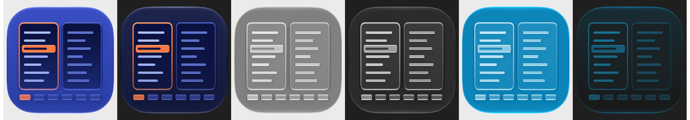

# Twin Panes

**A fast, keyboard-first, two-panel file manager for macOS, with a hex editor
built in.**

Twin Panes is for people who live in Norton Commander, Total Commander or
ForkLift and want that on a modern Mac. It has two panels side by side, tabs in
each, and F-keys for everything. Viewing and editing files happens in a tab of
the same window, so you never juggle a pile of separate windows.

The first piece is a **hex viewer and editor that handles files of 4 GB and
up**. A multi-gigabyte disk image, a core dump or a log file opens instantly and
scrolls smoothly, because Twin Panes reads only the part of the file you're
looking at.

<!-- Screenshots: docs/assets/screenshot-*.png go here. -->

## What it does today

Twin Panes is early and changing quickly. Right now it can:

- **Browse folders**: name, size, date and kind columns. Type to jump to a
  file, Return or ⌘↓ to go in, ⌘↑ or Backspace to go up, ⇧⌘G to type a path.
- **Open any file as hex** with F3, F4 or Return in the browser, with
  File › Open, by dropping a file (or folder) on the window, or with Finder's
  *Open With*.
- **Inspect large files**: a 4 GB file opens in well under a tenth of a second.
  Scrolling stays smooth and memory stays at tens of megabytes.
- **Search and inspect**: find hex or text (UTF-8, UTF-16 LE/BE, case-folding)
  across a whole 4 GB file with progress and cancel, highlight all matches, and
  decode the bytes under the cursor in the data inspector (⌥⌘I).
- **Navigate bytes**: go to an offset (⌘L), select ranges, and copy them as hex
  or text. A selection can also be saved to its own file.
- **Overwrite bytes** by typing hex digits or text, with changed bytes
  highlighted and unlimited undo and redo. Edits stay instant on a 4 GB file,
  even while a search is running. Saving them comes next.
- **Change the view**: offsets in hex or decimal, byte grouping, and an ASCII or
  Latin-1 text column.
- **Use Safari-style tabs**, each with a file icon and a close button.

Edits can't be saved yet: closing an edited tab asks before discarding them.

It runs in the macOS App Sandbox. It sees only the folders you grant it, and it
remembers those grants.

## Where it's going

In rough order:

1. **Saving**: saves that are near-instant and crash-safe, so edits made today
   can be written back. Unsaved edits survive the app crashing.
2. **The full file manager**: two panels, a sidebar, a Quick Look preview pane,
   an F-key bar, and copy, move, rename and trash with progress and conflict
   handling.
3. **More editing**: insert and delete bytes, plus plain-text and Markdown modes
   with find and replace.
4. **Later**: a built-in terminal, multiple windows, remote connections, folder
   compare and more.

The full plan, with every decision behind it, is in
[docs/PLAN.md](docs/PLAN.md).

## Requirements

- macOS 15 Sequoia or later
- A Mac with Apple silicon (there is no Intel build)

There are no downloadable releases yet. To try it, build it from source; see
[docs/DEVELOPMENT.md](docs/DEVELOPMENT.md).

## Contributing

Issues and ideas are welcome. To work on the code, start with
[docs/DEVELOPMENT.md](docs/DEVELOPMENT.md), which covers building, testing and
how the source is organized.

## License

Apache-2.0. See [LICENSE](LICENSE).
